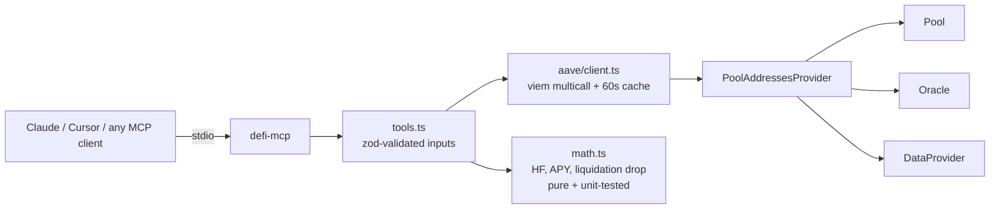

<div align="center">

# 🏦 defi-mcp

**Give your AI agent eyes on DeFi.**
An [MCP](https://modelcontextprotocol.io) server that lets Claude, Cursor or any MCP client read Aave V3 positions, compare markets and simulate the health-factor impact of an action — before anyone signs a transaction.


</div>

---

## Why

LLMs are good at explaining risk but blind to on-chain state. `defi-mcp` gives an agent a small set of **typed, read-only tools** so it can answer questions like:

> *"How close am I to liquidation on Base?"*
> *"If I borrow 2,000 USDC more, what happens to my health factor?"*
> *"Where's the best stablecoin supply rate right now — Arbitrum or Optimism?"*

No private keys, no signing, no transactions. The agent can **look and simulate**, the human decides.

## Tools

| Tool | What it does |
|---|---|
| `aave_markets` | All Aave V3 reserves on a chain: price, supply / borrow APY, LTV, liquidation threshold, utilization. Filter and sort. |
| `aave_account` | A wallet's position: collateral, debt, **health factor**, risk label, net APY, per-asset breakdown, and **how far each collateral price can drop before liquidation**. |
| `aave_simulate` | What-if for up to 10 chained actions (`supply` / `withdraw` / `borrow` / `repay`) → health factor after every step. Rejects impossible actions. |
| `wallet_balances` | Native + ERC-20 balances (Aave reserve tokens) with USD values. |

**Chains:** Ethereum · Base · Arbitrum · Optimism · Polygon

## Architecture



- **One address per chain.** Only Aave's `PoolAddressesProvider` is hard-coded; Pool, Oracle and DataProvider are resolved at runtime, so protocol upgrades don't break the server.
- **Multicall everywhere.** A full account read is ~3 RPC round-trips regardless of how many reserves a chain has.
- **Pure risk math.** Health factor, APY compounding and liquidation-price math live in `math.ts` with no network access and are covered by tests.

## Quick start

```bash
git clone https://github.com/StanislavV01/defi-mcp && cd defi-mcp
npm install && npm run build
```

### Claude Desktop

Add to `claude_desktop_config.json`:

```json
{
  "mcpServers": {
    "defi": {
      "command": "node",
      "args": ["/absolute/path/to/defi-mcp/dist/index.js"],
      "env": { "RPC_URL_BASE": "https://your-base-rpc" }
    }
  }
}
```

### Claude Code

```bash
claude mcp add defi -- node /absolute/path/to/defi-mcp/dist/index.js
```

### Try it in the MCP Inspector

```bash
npm run inspect
```

## Configuration

Public RPCs work out of the box but are rate-limited. For real use set your own:

| Variable | Chain |
|---|---|
| `RPC_URL_ETHEREUM` | Ethereum |
| `RPC_URL_BASE` | Base |
| `RPC_URL_ARBITRUM` | Arbitrum |
| `RPC_URL_OPTIMISM` | Optimism |
| `RPC_URL_POLYGON` | Polygon |

## Example

**You:** *Check 0x… on Base. If I borrow 1,500 USDC, am I still safe?*

The agent calls `aave_account`, then `aave_simulate`:

```json
{
  "before": { "healthFactor": 2.49, "debtUsd": 1000 },
  "after":  { "healthFactor": 0.996, "debtUsd": 2500 },
  "risk": "LIQUIDATABLE",
  "warning": "This sequence would make the position liquidatable — Aave would reject the borrow/withdraw."
}
```

…and explains why, instead of guessing.

## Development

```bash
npm run dev        # run from source
npm test           # unit tests (node:test)
npm run typecheck
```

## Limitations

- Simulation does not model **eMode**, isolation mode or interest accrual — results are estimates, clearly labelled as such.
- Read-only by design. Transaction building lives in the companion project **DeFi Agent** (coming next).

## Roadmap

- [ ] eMode-aware simulation
- [ ] More protocols (Morpho, Compound V3)
- [ ] `prepare_transaction` tool returning unsigned calldata for human signing
- [ ] Publish to npm (`npx defi-mcp`)

## License

MIT © Stanislav Verbytskyi
